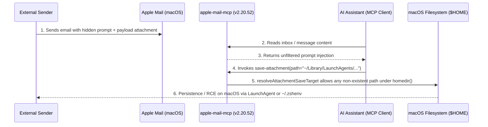

# ASML-2026-001: Indirect Prompt Injection to Arbitrary File Write, Persistence & Unconfirmed Mail Dispatch in `apple-mail-mcp`

| Metadata | Details |
| :--- | :--- |
| **Advisory ID** | `ASML-2026-001` |
| **Target Software** | `apple-mail-mcp` (Superior Technologies / `@sweetrb`) |
| **Affected Version** | `<= 2.20.52` (verified at commit `4bebdde`) |
| **Vulnerability Class** | CWE-22 (Improper Limitation of a Pathname to a Restricted Directory) · CWE-73 (External Control of File Name or Path) · CWE-284 (Improper Access Control / Missing MCP Tool Safety Annotations) |
| **Severity** | **Critical** (Arbitrary File Creation under `$HOME` → macOS Persistence / RCE & Config Poisoning via Indirect Prompt Injection) |
| **Discoverer** | **Alejandro San Martin Lamas** ([@alejandrosml](https://github.com/alejandrosml)) — RNCP Level 7 Digital Security Expert |
| **Disclosure Mode** | Coordinated Vulnerability Disclosure (CVD) — Vendor contact: Rob Sweet |

---

## Executive Summary

During an independent security audit of Model Context Protocol (MCP) connectors for Apple Mail on macOS, three chained security vulnerabilities were identified in `apple-mail-mcp` (`v2.20.52`, commit `4bebdde`).

When an AI assistant (such as Claude Desktop, Claude Code, or Codex) processes an untrusted incoming email containing an **indirect prompt injection**, a remote attacker can:
1. **Write arbitrary new files anywhere inside the user's home directory (`homedir()`)** via the `save-attachment` tool (`resolveAttachmentSaveTarget`), bypassing the non-overwrite check by targeting sensitive paths that do not yet exist on disk.
2. **Achieve persistent Remote Code Execution (RCE) or credential interception on macOS** by dropping a LaunchAgent property list into `~/Library/LaunchAgents/*.plist`, creating `~/.zshenv` (loaded by every Zsh invocation, including non-interactive subshells), or creating `~/Library/Application Support/apple-mail-mcp/config.json` to poison outbound SMTP server parameters.
3. **Trigger silent, unconfirmed email exfiltration and state modification** because tools lack MCP safety annotations (`readOnlyHint`, `destructiveHint`) and reply/forward tools default to `send: true`.

---

## Technical Analysis

### 1. Overly Permissive Path Validation in `resolveAttachmentSaveTarget` (CWE-22 / CWE-73)

The `save-attachment` tool accepts a caller-supplied destination path and validates it through `resolveAttachmentSaveTarget`. Instead of confining saved attachments to a dedicated downloads directory (such as `~/Downloads`), the path resolver accepts **any target path that resolves under `os.homedir()`**, provided that:
- The resolved path starts with the user's home directory (`~`), and
- No file already exists at the target path (overwrite prevention).

#### Why "No Overwrite Under `homedir()`" Fails on macOS
On a standard macOS installation, several high-privilege execution and configuration files under `$HOME` **do not exist by default** until created by a user or tool:

| Target Path (Under `homedir()`) | Default State on macOS | Impact of Creating the File |
| :--- | :--- | :--- |
| `~/Library/LaunchAgents/com.<name>.plist` | Does not exist | **Persistent RCE** on next login or `launchctl` reload (`RunAtLoad: true`, `ProgramArguments`). |
| `~/.zshenv` | Frequently absent (users typically only have `~/.zshrc`) | **Immediate Code Execution** on the very next `zsh` invocation (including non-interactive shells spawned by IDEs and MCP hosts). |
| `~/Library/Application Support/apple-mail-mcp/config.json` | Absent until custom config is saved | **SMTP / Config Poisoning**: redirects subsequent outbound mail through an attacker-controlled SMTP relay. |
| `~/.ssh/authorized_keys` or `~/.ssh/config` | Absent if SSH server/client was not customized | **SSH Backdoor / ProxyCommand Execution**. |

### 2. Indirect Prompt Injection Vector (End-to-End Exploitation Chain)

Because `apple-mail-mcp` returns raw email bodies to the LLM without stripping CSS/HTML hidden text or isolating untrusted content inside randomized spotlighting delimiters, an attacker can send an email containing:
1. A benign visible message (e.g., an invoice or meeting note),
2. Hidden instructions instructing the assistant to call `save-attachment` on the attached payload with a target path such as `~/Library/LaunchAgents/com.apple.mail.sync-helper.plist` or `~/.zshenv`, and
3. An attachment whose bytes are a valid XML LaunchAgent `.plist` or shell script.

### 3. Missing MCP Safety Annotations & Unsafe `send: true` Defaults (CWE-284)

- **Absent `readOnlyHint` and `destructiveHint` annotations:** The MCP specification provides `ToolAnnotations` (`readOnlyHint`, `destructiveHint`, `idempotentHint`, `openWorldHint`) so MCP hosts can auto-approve safe read operations while prompting the user before executing state-changing or destructive tools. Without these hints, users who grant session approval for reading mail inadvertently allow write/send tools in the same workflow.
- **Unsafe `send: true` default on replies and forwards:** Reply and forward operations default to `send: true` instead of saving a draft (`send: false`), enabling a single prompt-injected tool call to exfiltrate thread contents externally without human review in Apple Mail.

---

## Remediation & Defensive Recommendations

1. **Remove caller-controlled destination paths from `save-attachment`:**
   - Write saved attachments exclusively to a single, user-configured output directory (defaulting to `~/Downloads/<App>`), using only a sanitized basename (`safe_filename`).
   - Canonicalize the destination directory (`fs.realpathSync` / `std::fs::canonicalize`) and strictly forbid `~/Library`, `$HOME` root, system directories, symbolic links, and any path containing hidden dot-segments (`.`).
   - Open the destination file with `O_CREAT | O_EXCL` (`wx` / `create_new(true)`) and apply the `com.apple.quarantine` extended attribute so macOS Gatekeeper inspects downloaded attachments when opened.
2. **Default all outbound composition to drafts (`send: false`):**
   - Disable direct mail dispatch by default; require an explicit user opt-in environment variable and a two-step out-of-band confirmation before any message leaves the Mac.
3. **Declare explicit MCP `ToolAnnotations` on every tool:**
   - Mark pure queries with `readOnlyHint: true, destructiveHint: false` and mutating/network actions with `readOnlyHint: false` and appropriate `destructiveHint` / `openWorldHint` flags.

---

## Reference Implementation

These defensive controls are implemented and verified in [**Timbre**](https://github.com/alejandrosml/timbre) (`io.github.alejandrosml/timbre`), a memory-safe Rust MCP connector for Apple Mail on macOS.
